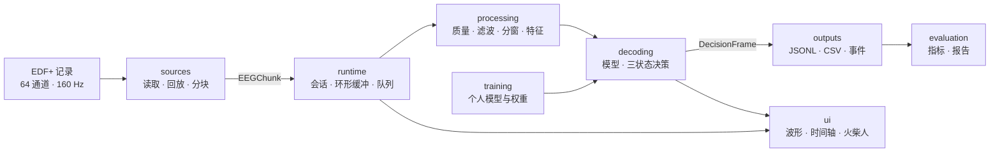

# 脑电运动想象连续解码桌面应用

BCI Motor Imagery · 离线 EEG 回放 · 连续三状态解码

用公开的 EEG 数据按原始采样时序回放，持续判断**空闲 / 左手运动想象 / 右手运动想象**，并把滚动波形、双轨时间轴、火柴人反馈与结构化存档串成一条可复现的处理链。推理过程不读取任务标签或试次时间表。

> **当前状态（2026-10-22，W1）**
> 仓库处于**脚手架阶段**：目录、模块边界和 1.0 契约已经规划，但所有模块文件均为 0 字节占位，`pyproject.toml`、CI、依赖清单与文档尚未填写，**应用还不能运行**。本 README 同时是开发约定与目标形态说明，随实现推进更新。

---

## 目录

- [1. 项目简介](#1-项目简介)
- [2. 当前状态](#2-当前状态)
- [3. 功能范围（P0）](#3-功能范围p0)
- [4. 系统架构](#4-系统架构)
- [5. 目录结构](#5-目录结构)
- [6. 快速开始](#6-快速开始)
- [7. 数据、标签与输出](#7-数据标签与输出)
- [8. 处理与决策参数](#8-处理与决策参数)
- [9. 评估口径](#9-评估口径)
- [10. 团队分工](#10-团队分工)
- [11. 开发规范](#11-开发规范)
- [12. 文档索引](#12-文档索引)
- [13. 路线图](#13-路线图)
- [14. 已知限制](#14-已知限制)
- [15. 数据来源与参考](#15-数据来源与参考)
- [16. 许可证](#16-许可证)

---

## 1. 项目简介

本项目是课程与企业项目验收场景下的 Windows 桌面应用。首版在**不接触真人设备**的前提下，使用 PhysioNet EEG Motor Movement/Imagery 数据集的 EDF+ 记录做 1 倍速回放，验证从原始采样到运动想象判断、可视化反馈和结果保存的完整链路。

设计要点：

- **连续自主检测**：持续处理整段数据，不用标签或试次时间表决定何时分类、何时允许动作。
- **状态可区分**：预热、空闲、左手、右手、不确定、异常六种模型状态；运行状态与模型状态分开保存。
- **标签隔离**：读取层把 EEG 与参考标注拆成不同对象，在线路径只接收数据块与采样元数据。
- **可核对**：每个结果都带证据窗、质量标记、模型与配置版本，能回到原始样本复核。
- **可替换**：数据源、解码器、结果接收器都按协议实现，P0 先交付 EDF 回放与 JSONL 存档。

首版识别**同一受试者、已训练过的类别**，不解释任意思想内容，也不代表临床或通用脑机接口能力。

## 2. 当前状态

| 部分 | 状态 | 说明 |
| --- | --- | --- |
| 目录与模块边界 | ✅ 完成 | `src/eeg_core` + `src/eeg_app` 分层，`contracts` 独立成包 |
| 接口契约 1.0 | 🟡 规划完成 | 字段定义见 [docs/01](docs/01_接口约定_1.0.md)，实现待补 |
| 数据读取与回放 | ⬜ 未开始 | `sources/`、`runtime/` 为空占位 |
| 处理与解码 | ⬜ 未开始 | `processing/`、`decoding/` 为空占位 |
| 界面 | ⬜ 未开始 | `ui/` 为空占位 |
| 存档与评估 | ⬜ 未开始 | `outputs/`、`evaluation/` 为空占位 |
| 打包与发布 | ⬜ 未开始 | `packaging/` 为空占位 |
| 工程配置 | ⬜ 空占位 | `pyproject.toml`、CI、`requirements*.txt` 尚未填写 |

> 在 `pyproject.toml` 与模块实现补齐前，下文的安装、启动、测试命令**不会成功**；它们描述的是目标用法。

## 3. 功能范围（P0）

P0 共 11 项功能，全部完成后才进入验收；P1（网络流、LSL、额外模型）在 P0 通过后再安排。

| 编号 | 功能 | 主责 | 验收用例 |
| --- | --- | --- | --- |
| F01 | 读取受支持 EDF+，规范通道名/单位，校验采样率、通道、参考策略与模型元数据；不兼容时阻止运行 | A | T02 |
| F02 | 1 倍速连续供数；开始、暂停、继续、停止、文件结束；状态与样本编号一致 | A | T03、T06、T11 |
| F03 | 质量检查、因果滤波、状态保持、异常后清理与预热；不得使用未来样本 | B | T04、T05、T07 |
| F04 | 连续分窗提取特征，调用个人模型输出三状态分数 | B | T03、T10 |
| F05 | 依据质量、门限与时间一致性产生决策；区分空闲/不确定/异常；处理结果过期 | B | T06、T07、T10 |
| F06 | 持续显示带单位的波形，可切换通道与幅度；绘图不阻塞解码 | C | T08、T11 |
| F07 | 绘制模型预测轨与独立参考轨；两轨互不驱动 | C | T03、T08 |
| F08 | 火柴人与文字只响应有效模型决策；暂停、异常、停止或过期后静止 | C | T06、T07、T08 |
| F09 | 会话自动存档：元数据、逐窗结果、事件、运行状态、结束原因 | D | T09、T12 |
| F10 | 版本化结果结构、CSV 导出、可替换 ResultSink 与独立读取样例 | D | T09、T10 |
| F11 | Windows 离线包、样例、模型、使用说明、依赖与数据来源说明、评估报告 | D | T01、T10、T11 |

非功能目标（初始值，验收前冻结）：

| 编号 | 要求 |
| --- | --- |
| N01 | 64 通道 / 160 Hz 输入，固定候选通道，8 通道 10 秒波形 |
| N02 | 分窗齐备后单窗处理耗时 P95 ≤ 100 ms |
| N03 | 数据块释放到界面结果的附加延迟 P95 ≤ 300 ms |
| N04 | 波形刷新 ≥ 15 次/秒（目标 20 次/秒） |
| N05 | 稳态工作集 ≤ 2 GB，30 分钟无持续增长 |
| N06 | 无开发环境、断网电脑可离线运行 |
| N07 | 暂停/停止后 250 ms 内停止动作反馈 |
| N08 | 结果发布后 750 ms 内无新有效决策则停止动作反馈 |

## 4. 系统架构

### 4.1 分层

- **`src/eeg_core`**：纯核心库，不依赖 UI、运行时与 IO 框架，可在测试与训练脚本中单独使用。
  - `contracts/`：数据帧、事件、配置、协议（A 维护，全员复核）
  - `processing/`：质量、因果滤波、分窗、特征（B）
  - `decoding/`：模型结构、加载推理、决策（B）
- **`src/eeg_app`**：应用层，负责把核心库接成可运行程序。
  - `sources/`、`runtime/`：数据源、会话、缓冲、队列（A）
  - `ui/`：窗口、波形、时间轴、火柴人、状态文案（C）
  - `outputs/`：存档、导出、ResultSink（D）
  - `app.py` / `__main__.py`：依赖组装与入口（A）
- **离线部分**：`training/`（B）、`evaluation/`（D）、`packaging/`（D）。

### 4.2 数据流



### 4.3 接口契约

统一契约版本 `1.0`，字段变更须先更新契约与样例，再改双方模块。

**EEGChunk**（A → 处理/显示）

| 字段 | 含义 |
| --- | --- |
| `schema_version` | 契约版本，固定 `1.0` |
| `source_id` / `recording_id` | 数据来源与原始记录编号 |
| `seq` / `start_sample` | 块编号与首样本零基编号 |
| `sample_rate_hz` / `channel_names` | 采样率与通道顺序 |
| `samples` | `通道数 × 样本数` 的数组，内部单位**伏** |
| `released_monotonic_ms` | 该块实际释放时的会话单调时钟 |
| `discontinuity` | 是否为新记录或已知间断边界 |

**DecisionFrame**（B → C/D）

包含 `decision_state`（`warming_up` / `idle` / `left_hand` / `right_hand` / `uncertain` / `invalid`）、`intent`、`scores`（idle/left/right）、证据窗 `window_start_sample`–`window_end_sample`（左闭右开）、`source_t_sec`、质量标记、`model_id` / `pipeline_version` / `config_hash`、`valid_for_ms` 等字段。

**会话状态**：`Ready → Running ⇄ Paused → Stopped / Finished / Error`，与模型状态分开保存。

**事件**：`IntentEvent` 记录一次连续同类动作的起止、关联决策编号与结束原因；停止、异常、文件结束都必须关闭当前事件。

## 5. 目录结构

```text
bci-motor-imagery/
├── src/
│   ├── eeg_core/                 # 纯核心库：不依赖 UI / IO
│   │   ├── contracts/            # 数据帧、事件、配置、协议
│   │   ├── processing/           # 质量、滤波、分窗、特征
│   │   └── decoding/             # 模型结构、推理、决策
│   └── eeg_app/                  # 应用层：UI、运行时、数据源、输出
│       ├── app.py                # 依赖组装与启动
│       ├── ui/                   # 主窗口、波形、时间轴、火柴人、文案
│       ├── runtime/              # 会话、环形缓冲、后台队列
│       ├── sources/              # EDF 读取与回放
│       └── outputs/              # 存档、导出、ResultSink
├── training/                     # 训练入口、数据登记、checkpoints/
├── evaluation/                   # 指标唯一实现、事件、报告
├── tests/                        # unit/core、unit/runtime、unit/evaluation、integration
├── examples/                     # 合成 EEG 与极小回放样本
├── packaging/                    # PyInstaller spec 与构建脚本
├── scripts/                      # 环境自检、演示、锁文件导出
├── docs/                         # 00–07 技术文档，project/ 放管理文档
├── data/                         # 数据说明（.edf 不入库）
├── pyproject.toml                # 包定义、入口点、依赖、pytest/ruff
└── .github/workflows/            # lint + pytest、Windows 打包 smoke test
```

## 6. 快速开始

### 6.1 环境要求

- Windows 10/11 64 位（首版仅验收 Windows）
- Python **3.13.16**（64 位）
- 无需 GPU；推理在 CPU 上完成

| 依赖 | 版本 | 用途 |
| --- | --- | --- |
| numpy | 2.5.4 | 数组与数值计算 |
| scipy | 1.18.1 | Butterworth SOS 因果滤波 |
| mne | 1.13.2 | EDF+ 读取、通道标准化 |
| scikit-learn | 1.9.1 | 收缩 LDA |
| PySide6 | 6.12.0 | Qt 桌面界面 |
| pyqtgraph | 0.14.0 | 波形与时间轴绘图 |
| PyInstaller | 6.22.3 | 离线打包（仅发布时需要） |
| pytest / ruff | 开发依赖，版本待锁 | 测试与静态检查 |

### 6.2 安装与启动

```powershell
git clone https://github.com/River20071017/bci-motor-imagery.git
cd bci-motor-imagery

py -3.13 -m venv .venv
.\.venv\Scripts\python.exe -m pip install --upgrade pip
.\.venv\Scripts\python.exe -m pip install -e ".[dev]"

# 环境自检（检查版本与基础导入，不安装、不升级）
.\.venv\Scripts\python.exe scripts\check_env.py

# 启动应用（入口点 eeg-app；也可用 python -m eeg_app）
eeg-app
```

> 以上命令对应目标形态：`pyproject.toml`、`requirements.txt`、`scripts/check_env.py` 与 `eeg_app` 目前都是占位，需先补齐依赖、`[project.scripts]` 入口与模块实现。

### 6.3 测试与检查

```powershell
.\.venv\Scripts\python.exe -m pytest
.\.venv\Scripts\python.exe -m ruff check .
.\.venv\Scripts\python.exe -m pre_commit run --all-files
```

测试分层：`tests/unit/core`（契约、窗口、滤波、质量、决策）、`tests/unit/runtime`（缓冲、队列）、`tests/unit/evaluation`（指标）、`tests/integration`（回放端到端、sink 写入）。

## 7. 数据、标签与输出

### 7.1 数据来源

- 数据集：[PhysioNet EEG Motor Movement/Imagery](https://physionet.org/content/eegmmidb/1.0.0/)，64 通道 EEG，160 Hz，EDF+
- 仅启用 **run 4 / 8 / 12** 的左右手运动想象；T0、T1、T2 分别映射为 `idle`、`left_hand`、`right_hand`
- 通道顺序与单位以记录为准；文件未写明的参考方式标为「未提供」，不猜测
- 原始数据不入库，`data/*.edf` 已在 `.gitignore` 中忽略

### 7.2 固定划分

| 用途 | 数据 | 允许的操作 |
| --- | --- | --- |
| 开发受试者 | S001–S005 的 run 4、run 8 | 检查流程、拟合模型、选择少量参数 |
| 正式受试者 | 预登记 S001–S010 | 每人同一协议训练个人模型，不按测试成绩筛人 |
| 训练 | 每人的 run 4 | 拟合模型与所有需要学习的变换 |
| 验证 | 每人的 run 8 | 选通道、门限、时间规则 |
| 封存测试 | 每人的 run 12 | 冻结后一次性生成正式评估 |

标准化、CSP 等学习步骤只在训练数据上拟合；不将重叠窗口随机划分；所有受试者使用同一选择规则。

### 7.3 会话输出

```text
session_<会话编号>/
  manifest.json     # 应用、契约、模型、配置、依赖版本、源文件校验值
  decisions.jsonl   # 每个更新点的决策、证据窗、质量与时间信息
  events.csv        # 动作事件起止、类别、结束原因、关联决策编号
  runtime.jsonl     # 开始、暂停、恢复、间断、过载、写入失败、结束
  summary.json      # 完成状态、各状态时长、事件数、性能统计
```

写文件使用独立队列；普通停止必须排空队列，强制终止后允许丢失最后一次刷新，并在恢复时标记会话未正常结束。

## 8. 处理与决策参数

以下为初始工程配置，验证阶段允许小范围比较并冻结；正式测试前固定。

| 参数 | 初始值 |
| --- | --- |
| 回放速率 | 1 倍速 |
| 供数粒度 | 目标 50 ms 一块（160 Hz 约 8 样本，允许块长变化） |
| 模型通道 | FC3、FCz、FC4、C3、Cz、C4、CP3、CPz、CP4 |
| 参考策略 | 模型通道平均参考，训练与运行一致 |
| 特征频带 | 8–13 Hz、13–30 Hz |
| 滤波 | 四阶 Butterworth SOS，分块保留状态，因果 |
| 特征 | 每个通道、每个频带的对数方差（下限固定） |
| 分类器 | 三状态收缩 LDA（`solver="lsqr"`、`shrinkage="auto"`） |
| 观察窗 / 步长 | 最近 2 秒 / 250 ms |
| 预热 | 至少 3 秒连续有效数据 |
| 环形缓冲 | 固定 30 秒 |
| 发布门限 | 最高分 ≥ 0.65 且领先第二名 ≥ 0.15，连续 3 个更新点确认 |
| 结果有效期 | `valid_for_ms = 750` |

质量规则检查非有限值、必需通道缺失、样本跳变、采样间隔异常、常量段与异常幅值；任一模型通道不合格时当前结果为 `invalid`，清理历史并重新预热。**低分不能直接转成 idle。**

积压超过 500 ms 显示过载，超过 1 秒暂停回放并清理未处理数据，记录 `overrun` 后重新预热。

## 9. 评估口径

对封存测试记录做全程因果回放，在每个 250 ms 决策点比较参考状态与发布状态；稳定区间指标排除标签转换前后各 1 秒与记录起始 3 秒预热区，并报告排除时长。

| 指标 | 定义 | 建议线 |
| --- | --- | --- |
| 三状态宏平均 F1 | 三类 F1 取均值，再按受试者等权平均 | ≥ 0.50 |
| 左右手平衡召回 | 左手与右手召回的平均 | ≥ 0.60 |
| 空闲误触发率 | T0 内起始的动作事件数 ÷ T0 累计分钟 | ≤ 2 次/分钟 |
| 有效决策覆盖率 | 发布三类状态的决策点 ÷ 稳定区间决策点 | 报告 |
| 拒判与异常比例 | uncertain / invalid / warming_up 占比 | 报告 |
| 事件检出率 | 每个参考区间是否至少一次同类确认输出 | 报告 |
| 首次输出时延 | 首次同类确认输出源时间 − 区间起点 | 中位数、P95 |
| 停止延迟 | 区间结束后离开该动作的时间 | 分布 |

`uncertain` / `invalid` / `warming_up` 在有点级参考类别时计入该类遗漏，不能从分母删除。所有时延都称为「相对任务标注的时延」，不代表测到真实意图出现的瞬间。

## 10. 团队分工

| 代号 | 角色 | 主责模块 |
| --- | --- | --- |
| A | 项目协调 · 输入集成 | `contracts/`、`sources/`、`runtime/`、`app.py`、测试与工程配置、CI |
| B | 数据与连续解码 | `processing/`、`decoding/`、`training/`、模型包 |
| C | 桌面界面与反馈 | `ui/`（窗口、波形、时间轴、火柴人、状态文案） |
| D | 输出与评估发布 | `outputs/`、`evaluation/`、`packaging/`、评估报告与离线包 |

四条硬边界：

1. **契约只由 A 合入**：改 `contracts/` 前先通知 B/C/D，样例与文档同步更新。
2. **指标只在 D 处计算**：`evaluation/metrics.py` 是唯一实现，`training/evaluate.py` 只调用。
3. **界面不改写结果**：C 只渲染 `DecisionFrame`，动画不得由参考标签触发。
4. **在线路径不见标签**：训练/评估可读参考轨，`sources/`、`runtime/` 与解码路径不得触碰。

详细计划与交接点见 [docs/project/06_周计划与分工.md](docs/project/06_周计划与分工.md)；模块与文件的对应关系见 [团队分工与文件地图.html](团队分工与文件地图.html)。

## 11. 开发规范

- **分支**：一个任务一个分支（如 `feat/A-metainfo`），合入前由另一位成员复核；不直接向 `main` 推送。
- **提交**：说明「做了什么、为什么、如何验证」；接口、指标或用户可见行为变化时同步更新文档。
- **代码风格**：ruff 负责 lint 与格式化，pre-commit 在提交前运行；测试用 pytest。
- **测试**：核心逻辑必须有单测；集成测试覆盖「回放 → 处理 → 决策 → 输出」。
- **数据与模型**：不提交 `.edf`、权重和运行产物；模型包必须带版本与校验信息。
- **AI 辅助**：可以使用，但提交者对结果负责；关键算法、计分与状态清理不能只凭解释判断正确。

## 12. 文档索引

| 文档 | 内容 |
| --- | --- |
| [docs/README.md](docs/README.md) | 文档索引与阅读顺序 |
| [docs/00_架构总览.md](docs/00_架构总览.md) | 分层、数据流、模块边界 |
| [docs/01_接口约定_1.0.md](docs/01_接口约定_1.0.md) | EEGChunk / DecisionFrame 字段与示例 |
| [docs/02_数据与标签说明.md](docs/02_数据与标签说明.md) | 数据来源、T0/T1/T2、划分与校验 |
| [docs/03_评价口径与指标.md](docs/03_评价口径与指标.md) | 指标定义、计分实现、报告格式 |
| [docs/04_运行与打包.md](docs/04_运行与打包.md) | 运行步骤、离线打包与验收 |
| [docs/05_变更记录.md](docs/05_变更记录.md) | 接口与版本变更 |
| [docs/07_已知限制.md](docs/07_已知限制.md) | 限制、未完成项与失败记录 |
| [docs/project/06_周计划与分工.md](docs/project/06_周计划与分工.md) | W1–W8 计划与责任 |

## 13. 路线图

| 日期 | 里程碑 |
| --- | --- |
| 10-22 | 契约 1.0、数据划分、技术环境冻结 |
| 10-29 | 第一条「波形 + 连续基线」可运行链路 |
| 11-05 | 连续检测可行性、门限选择规则、内部验收线 |
| 11-12 | 时间轴、动画、质量状态与保存联调 |
| 11-19 | P0 功能与正式测试配置冻结 |
| 11-26 | 首轮正式测试报告与预发布包 |
| 12-03 | 候选发布版与演示材料 |
| 12-08 | 最终提交 |

## 14. 已知限制

- **个人模型**：每个受试者单独训练，换人或换数据必须换模型；结果不能解释为通用解码能力。
- **离线回放**：首版不接真实采集设备，不验证真人闭环、跨天或跨设备稳定性。
- **idle 的含义**：模型学到的 idle 对应数据集休息条件，不等于任意场景下的「空闲」。
- **标签不是真值**：参考标注是实验安排的时段，不是主观想象起止的测量；时延只能相对标注报告。
- **指标未实测**：文中所有数值均为拟定配置与建议线，需在验证与正式测试后冻结。
- **工程与算法分开报告**：功能通过不等于解码指标通过；未达标时保留真实结果。
- **当前不可运行**：仓库仍是 0 字节占位骨架，安装与启动命令在配置补齐后生效。

## 15. 数据来源与参考

- [PhysioNet EEG Motor Movement/Imagery Dataset](https://physionet.org/content/eegmmidb/1.0.0/)
- [MNE：读取 EDF 与通道标准化](https://mne.tools/stable/generated/mne.io.read_raw_edf.html)
- [MNE：运动想象 CSP + LDA 示例](https://mne.tools/stable/auto_examples/decoding/decoding_csp_eeg.html)（仅作组织参考，不代表本项目连续检测完成）
- [SciPy `sosfilt`：分块因果滤波](https://docs.scipy.org/doc/scipy/reference/generated/scipy.signal.sosfilt.html)
- [scikit-learn LDA](https://scikit-learn.org/stable/modules/generated/sklearn.discriminant_analysis.LinearDiscriminantAnalysis.html)
- [scikit-learn 数据泄漏与处理管线](https://scikit-learn.org/stable/common_pitfalls.html)
- [Qt for Python](https://doc.qt.io/qtforpython-6/) / [PyQtGraph](https://www.pyqtgraph.org/)
- [PyInstaller 运行模式](https://pyinstaller.org/en/stable/operating-mode.html)

## 16. 许可证

许可证待团队确认后补充；当前 `LICENSE` 为空占位，在明确授权前请勿对外分发。
